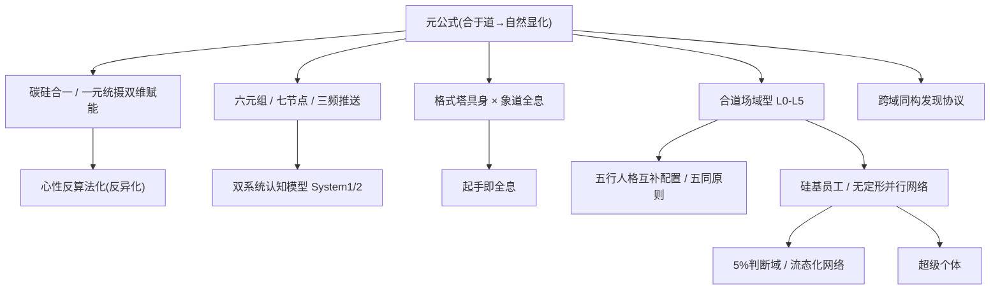
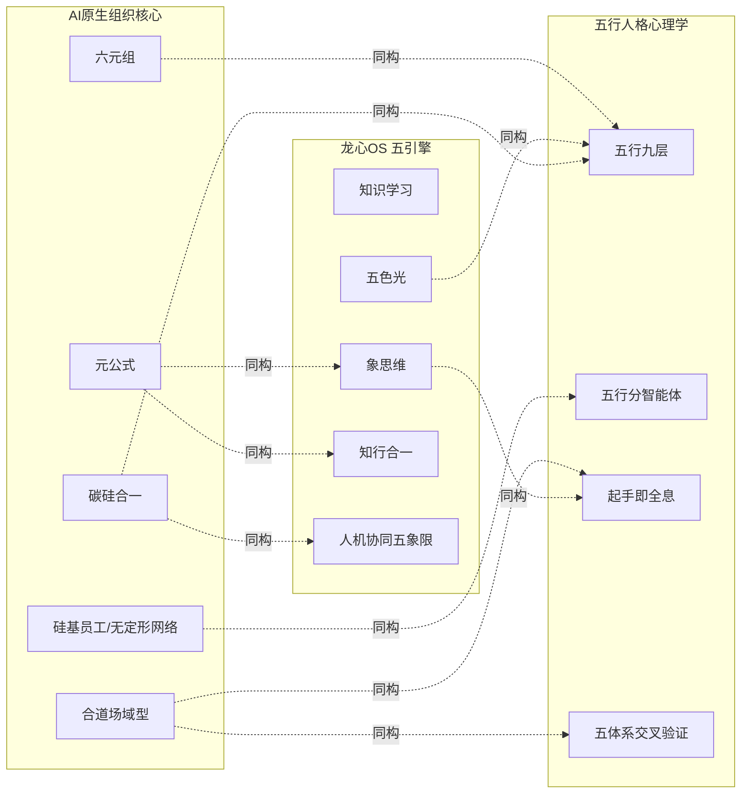

# 10-知识图谱 · AI原生组织（龙心OS mermaid 可视化）

## 图1 · 章节/分类树（63 份文档结构地图）

```mermaid
graph TD
  ROOT["AI原生组织理论 · 龙心OS结构化总索引"]
  C_10["顶层设计（土/B层）"]
  ROOT --> C_10
  N1["AI原生组织人才顶层…"]
  C_10 --> N1
  N2["AI原生组织数据结构…"]
  C_10 --> N2
  N3["AI原生组织顶层设计"]
  C_10 --> N3
  C_20["数据结构与业务流顶层设计（金/C层）"]
  ROOT --> C_20
  N4["AI原生组织数据结构…"]
  C_20 --> N4
  N5["业务流为载体，以数据…"]
  C_20 --> N5
  N6["味藏金枪鱼数据支撑业…"]
  C_20 --> N6
  N7["金枪鱼数据链——最小…"]
  C_20 --> N7
  C_30["文件原文件（火/B层）"]
  ROOT --> C_30
  N8["AI 原生组织公司的…"]
  C_30 --> N8
  N9["AI 原生组织公司的…"]
  C_30 --> N9
  N10["AI 原生组织特征"]
  C_30 --> N10
  N11["AI原生组织变革方向…"]
  C_30 --> N11
  N12["AI原生组织未来形态…"]
  C_30 --> N12
  N13["AI原生组织架构全案"]
  C_30 --> N13
  N14["AI原生组织认识框架…"]
  C_30 --> N14
  N15["AI原生组织讨论全记…"]
  C_30 --> N15
  N16["AI原生组织顶层设计…"]
  C_30 --> N16
  N17["AI原生组织顶层设计…"]
  C_30 --> N17
  N18["以象明道与全息：方法…"]
  C_30 --> N18
  N19["合道场域型 AI 原…"]
  C_30 --> N19
  N20["味藏 26 岗位智能…"]
  C_30 --> N20
  N21["味藏AI原生组织顶层…"]
  C_30 --> N21
  N22["格式塔具身与象道全息…"]
  C_30 --> N22
  N23["格式塔具身关系"]
  C_30 --> N23
  N24["破解创新瓶颈：AI原…"]
  C_30 --> N24
  N25["餐饮行业人机协同边界…"]
  C_30 --> N25
  C_40["讨论材料-录音转写（水/B层）"]
  ROOT --> C_40
  N26["Ai 原生组织变革"]
  C_40 --> N26
  N27["Ai 原生组织变革三…"]
  C_40 --> N27
  N28["Ai 原生组织变革三…"]
  C_40 --> N28
  N29["五行识人与沟通"]
  C_40 --> N29
  N30["五行领导力"]
  C_40 --> N30
  N31["人事"]
  C_40 --> N31
  N32["品牌定位"]
  C_40 --> N32
  N33["实时转写_录音11_…"]
  C_40 --> N33
  N34["实时转写_录音12_…"]
  C_40 --> N34
  N35["实时转写_录音13_…"]
  C_40 --> N35
  N36["实时转写_录音15_…"]
  C_40 --> N36
  N37["实时转写_录音16_…"]
  C_40 --> N37
  N38["实时转写_录音17_…"]
  C_40 --> N38
  N39["实时转写_录音20_…"]
  C_40 --> N39
  N40["实时转写_录音21_…"]
  C_40 --> N40
  N41["实时转写_录音22_…"]
  C_40 --> N41
  N42["实时转写_录音23_…"]
  C_40 --> N42
  N43["实时转写_录音24_…"]
  C_40 --> N43
  N44["实时转写_录音25_…"]
  C_40 --> N44
  N45["实时转写_录音26_…"]
  C_40 --> N45
  N46["实时转写_录音27_…"]
  C_40 --> N46
  N47["实时转写_录音28_…"]
  C_40 --> N47
  N48["实时转写_录音28_…"]
  C_40 --> N48
  N49["实时转写_录音30_…"]
  C_40 --> N49
  N50["实时转写_录音35_…"]
  C_40 --> N50
  N51["深度释义味藏品牌定位"]
  C_40 --> N51
  N52["老师"]
  C_40 --> N52
  N53["老师1"]
  C_40 --> N53
  N54["老师分享2"]
  C_40 --> N54
  N55["老师同频3"]
  C_40 --> N55
  N56["老师同频：市场➕会员"]
  C_40 --> N56
  N57["老师课堂2026.7…"]
  C_40 --> N57
  N58["老师，龙爪应用"]
  C_40 --> N58
  N59["闲谈"]
  C_40 --> N59
  C_50["马克思主义视角（木/A层）"]
  ROOT --> C_50
  N60["AI原生组织的哲学重…"]
  C_50 --> N60
  N61["碳硅合一演进框架"]
  C_50 --> N61
  N62["迈向AGI时代的个人…"]
  C_50 --> N62
  N63["马克思视野下的个人哲…"]
  C_50 --> N63

```

## 图2 · 核心概念体系（从元公式生发）

## 图3 · 跨域同构连接网（龙心OS ⟷ AI原生组织 ⟷ 五行人格）

<!-- AI-LINKS-BEGIN -->
## 🔗 AI 关联笔记（统一索引生成 · 2026-11-14）

> 由 `00-索引与导航/AI统一索引` 生成；可重跑覆盖，可用回滚脚本还原。

- [[01-核心体系/AI龙龟共生OS升级包3.0/龙龟升级/龙爪OS：AI原生组织岗位智能体/学习资料/岗位智能体生成器-开发文档（AI原生组织版）]] — 岗位智能体生成器 · 开发文档（AI原生组织版）
- [[01-核心体系/AI龙龟共生OS升级包3.0/龙龟升级/龙爪OS：AI原生组织岗位智能体/岗位智能体OS·顶层设计]] — 岗位智能体OS · 顶层设计
- [[03-知识地基层/AI原生组织四层体系/NS95769-01-马克思视野下的个人哲学]] — 马克思视野下的个人哲学·结构化知识文档
- [[03-知识地基层/AI原生组织四层体系/NS95769-02-AI原生组织顶层设计]] — AI原生组织顶层设计·结构化知识文档
- [[03-知识地基层/AI原生组织四层体系/NS95769-03-AI原生组织数据结构与业务流顶层设计]] — AI原生组织数据结构与业务流顶层设计·结构化知识文档
- [[03-知识地基层/AI原生组织四层体系/NS95769-04-AI原生组织人才顶层设计]] — AI原生组织人才顶层设计·结构化知识文档

<!-- AI-LINKS-END -->
