# AI原生组织思维模型 · 知识图谱

> 龙心 OS(1+5) 编译体系关系图（mermaid）。五大体系 → 各笔记；跨体系隐秘联系以虚线表示。

```mermaid
graph TD
  ROOT["AI原生组织思维模型"]
  S0["理论体系"]
  ROOT --> S0
  N_PERMA幸福理论["PERMA幸福理论（PERMA Th"]
  S0 --> N_PERMA幸福理论
  N_主体间性理论["主体间性理论"]
  S0 --> N_主体间性理论
  N_享乐适应理论["享乐适应理论"]
  S0 --> N_享乐适应理论
  N_他者["人文社科经典理论：他者（The Ot"]
  S0 --> N_他者
  N_保护动机理论["保护动机理论（Protection "]
  S0 --> N_保护动机理论
  N_创新抵抗理论["创新抵抗理论（Innovation "]
  S0 --> N_创新抵抗理论
  N_反脆弱性["人文社科经典理论：反脆弱性（Anti"]
  S0 --> N_反脆弱性
  N_嵌入理论["嵌入理论（Embeddedness "]
  S0 --> N_嵌入理论
  N_建构发展理论["建构发展理论"]
  S0 --> N_建构发展理论
  N_恐惧管理理论["恐惧管理理论 (Terror Man"]
  S0 --> N_恐惧管理理论
  N_情感事件理论["情感事件理论（Affective E"]
  S0 --> N_情感事件理论
  N_情绪认知评价理论["情绪认知评价理论 (Cognitiv"]
  S0 --> N_情绪认知评价理论
  N_意义构建理论["意义构建理论 (Sensemakin"]
  S0 --> N_意义构建理论
  N_敏捷治理["敏捷治理—Agile Governa"]
  S0 --> N_敏捷治理
  N_文本挖掘["文本挖掘（Text Mining）"]
  S0 --> N_文本挖掘
  N_最佳唤醒理论["最佳唤醒理论"]
  S0 --> N_最佳唤醒理论
  N_比较分析法["比较分析法（Comparative "]
  S0 --> N_比较分析法
  N_消费价值理论["消费价值理论（Theory of C"]
  S0 --> N_消费价值理论
  N_激励相容理论["激励相容理论（Incentive C"]
  S0 --> N_激励相容理论
  N_特质激活理论["特质激活理论（Trait Activ"]
  S0 --> N_特质激活理论
  N_社会促进理论["社会促进理论"]
  S0 --> N_社会促进理论
  N_社会支持理论["社会支持理论（Social Supp"]
  S0 --> N_社会支持理论
  N_社会视觉理论["社会视觉理论"]
  S0 --> N_社会视觉理论
  N_积极情绪的拓展_建构理论["积极情绪的拓展-建构理论"]
  S0 --> N_积极情绪的拓展_建构理论
  N_组织信息加工理论["组织信息加工理论（Organizat"]
  S0 --> N_组织信息加工理论
  N_自我呈现理论["自我呈现理论（Self-Presen"]
  S0 --> N_自我呈现理论
  N_解释水平理论["解释水平理论（Construal L"]
  S0 --> N_解释水平理论
  N_认知_情感_意动框架["认知-情感-意动框架（Cogniti"]
  S0 --> N_认知_情感_意动框架
  N_认知吝啬者理论["认知吝啬者理论"]
  S0 --> N_认知吝啬者理论
  N_资源保存理论["资源保存理论（Conservatio"]
  S0 --> N_资源保存理论
  N_过程调节法["过程调节法——一种提供因果证据的中介"]
  S0 --> N_过程调节法
  N_道德基础理论["道德基础理论"]
  S0 --> N_道德基础理论
  S1["思维模型·分类"]
  ROOT --> S1
  N__麦肯锡思考工具_理论体系梳理与应用研究["《麦肯锡思考工具》理论体系梳理与应用"]
  S1 --> N__麦肯锡思考工具_理论体系梳理与应用研究
  N_思维模型__人类认知的底层操作系统["思考的框架系列完整理论体系与实操指南"]
  S1 --> N_思维模型__人类认知的底层操作系统
  N_思维模型框["思维模型框架"]
  S1 --> N_思维模型框
  N_思维模式_方法论_解决问题_的模型["思维模式-方法论-解决问题”的模型"]
  S1 --> N_思维模式_方法论_解决问题_的模型
  N_掌握这100个思维模型_开启你的_超级个体_时代_["掌握这100个思维模型，开启你的「超"]
  S1 --> N_掌握这100个思维模型_开启你的_超级个体_时代_
  N_教员方法论["教员方法论：从本质洞察到闭环落地的系"]
  S1 --> N_教员方法论
  N_易经错综复杂["易经错综复杂"]
  S1 --> N_易经错综复杂
  N_框架_思维框架_框架思维["框架-思维框架-框架思维"]
  S1 --> N_框架_思维框架_框架思维
  N_第一性原理["第一性原理：不是天才的专属，是普通人"]
  S1 --> N_第一性原理
  N_金字塔原理["金字塔原理：一套可套用的表达框架"]
  S1 --> N_金字塔原理
  S2["思维模型·结构"]
  ROOT --> S2
  N_四维世界_道法术器势["四维世界：道法术器势！"]
  S2 --> N_四维世界_道法术器势
  N_多数人用_两仪_吵架_高手用_十方_破局["多数人用“两仪”吵架，高手用“十方”"]
  S2 --> N_多数人用_两仪_吵架_高手用_十方_破局
  N_思维提升_地图框架模型思维["思维提升：地图/框架/模型思维"]
  S2 --> N_思维提升_地图框架模型思维
  N_思维提升_界限思维["思维提升：界限思维"]
  S2 --> N_思维提升_界限思维
  N_思维提升_系统化思维["思维提升：系统化思维"]
  S2 --> N_思维提升_系统化思维
  N_思维提升_自驱动人格操作系统["思维提升：自驱动人格操作系统"]
  S2 --> N_思维提升_自驱动人格操作系统
  N_概念辨析_科学_VS_玄学["概念辨析：科学 VS 玄学"]
  S2 --> N_概念辨析_科学_VS_玄学
  N_结构化思维["思维提升：结构化思维"]
  S2 --> N_结构化思维
  N_读书方法论["四维世界：读书方法论"]
  S2 --> N_读书方法论
  N_谋局_矛_界限_盾_思维体系["思维提升：谋局（矛）界限（盾）思维体"]
  S2 --> N_谋局_矛_界限_盾_思维体系
  S3["思维模型·组合"]
  ROOT --> S3
  N_11种思维模型速查手册["11种思维模型速查手册：追根究底+结"]
  S3 --> N_11种思维模型速查手册
  N_5W2H七维分析["5W2H七维分析：一份标准化检查清单"]
  S3 --> N_5W2H七维分析
  N_6种提问法速查手册["6种提问法速查手册：苏格拉底式+五个"]
  S3 --> N_6种提问法速查手册
  N_7种高阶提问法速查手册["7种高阶提问法速查手册：澄清+系统+"]
  S3 --> N_7种高阶提问法速查手册
  N_8个沟通模型速查手册["8个沟通模型速查手册：SBI+汉堡包"]
  S3 --> N_8个沟通模型速查手册
  N_ORID焦点讨论法["ORID焦点讨论法：四层递进，看见事"]
  S3 --> N_ORID焦点讨论法
  N_SCAMPER奔驰法["SCAMPER奔驰法：七把钥匙，系统"]
  S3 --> N_SCAMPER奔驰法
  N__五层分析法["真正厉害的人，都在用这套「五层分析法"]
  S3 --> N__五层分析法
  N_三步矫正思维陷阱["三步矫正思维陷阱：捕捉自动思维+苏格"]
  S3 --> N_三步矫正思维陷阱
  N_五维重构法["反转、放大、缩小、替换、删除：五维重"]
  S3 --> N_五维重构法
  N_五维问题拆解法["五维问题拆解法：第一性原理打地基+分"]
  S3 --> N_五维问题拆解法
  N_从一团乱麻到清晰方案["从一团乱麻到清晰方案：一套从发散到检"]
  S3 --> N_从一团乱麻到清晰方案
  N_从复杂到简单["从复杂到简单：一套人人都能学会的问题"]
  S3 --> N_从复杂到简单
  N_从锚定方向到破局突围["从锚定方向到破局突围：一套覆盖全流程"]
  S3 --> N_从锚定方向到破局突围
  N_价值聚焦["价值聚焦：把负面问题，转化成正向创造"]
  S3 --> N_价值聚焦
  N_动力从来不是行动的前提["动力从来不是行动的前提，而是行动的结"]
  S3 --> N_动力从来不是行动的前提
  N_十种知识整合方式["十种知识整合方式：结构化+流程化+因"]
  S3 --> N_十种知识整合方式
  N_双系统理论["双系统理论：一套理解人类所有决策偏差"]
  S3 --> N_双系统理论
  N_如果X_那么Y["如果X，那么Y：骗过怠惰大脑，让行动"]
  S3 --> N_如果X_那么Y
  N_批判性思维["批判性思维：守住你的思想边界，做信息"]
  S3 --> N_批判性思维
  N_概率思维["概率思维：接纳不确定性，做长期稳赢的"]
  S3 --> N_概率思维
  N_第一层到第二层["从第一层到第二层：一套深度推演法，让"]
  S3 --> N_第一层到第二层
  N_苏格拉底6大提问框架["苏格拉底6大提问框架：澄清+假设+证"]
  S3 --> N_苏格拉底6大提问框架
  N_视角转换工具箱["视角转换工具箱：人物视角+时间视角+"]
  S3 --> N_视角转换工具箱
  N_逆向思维工具箱["逆向思维工具箱：反转型+转换型+缺点"]
  S3 --> N_逆向思维工具箱
  N_问题的答案["问题的答案，永远超不过问题的质量：一"]
  S3 --> N_问题的答案
  S4["象思维体系"]
  ROOT --> S4
  N_以象入道_以化见真__释_象道思维_["以象入道，以化见真——释“象道思维”"]
  S4 --> N_以象入道_以化见真__释_象道思维_
  N_象思维理论["象思维理论"]
  S4 --> N_象思维理论
  N_象思维理论体系_回归原创之思与实["象思维理论体系：回归原创之思与实践路"]
  S4 --> N_象思维理论体系_回归原创之思与实
  N_象思维理论体系_回归原创之思与实践路径["象思维理论体系：回归原创之思与实践路"]
  S4 --> N_象思维理论体系_回归原创之思与实践路径
  N_象道思维__观_比_体_化_四字循环法["象道思维：“观·比·体·化”四字循环"]
  S4 --> N_象道思维__观_比_体_化_四字循环法
  N_象道思维__观_比_体_化_四字循环法2["象道思维：“观·比·体·化”四字循环"]
  S4 --> N_象道思维__观_比_体_化_四字循环法2
  S5["元资料"]
  ROOT --> S5
  N_龙脑OS升级___专业建议["龙脑OS升级 · 专业建议"]
  S5 --> N_龙脑OS升级___专业建议
  N_龙脑OS升级___专业建议 -.-> N__麦肯锡思考工具_理论体系梳理与应用研究
  N_龙脑OS升级___专业建议 -.-> N_11种思维模型速查手册
  N_龙脑OS升级___专业建议 -.-> N_思维提升_地图框架模型思维
  N_龙脑OS升级___专业建议 -.-> N_掌握这100个思维模型_开启你的_超级个体_时代_
  N_龙脑OS升级___专业建议 -.-> N_思维模型__人类认知的底层操作系统
  N__麦肯锡思考工具_理论体系梳理与应用研究 -.-> N_思维提升_地图框架模型思维
  N__麦肯锡思考工具_理论体系梳理与应用研究 -.-> N_结构化思维
  N_思维模型__人类认知的底层操作系统 -.-> N_思维提升_地图框架模型思维
  N_思维模型__人类认知的底层操作系统 -.-> N_多数人用_两仪_吵架_高手用_十方_破局
  N_思维模型__人类认知的底层操作系统 -.-> N_思维提升_系统化思维
  N_思维模型框 -.-> N_龙脑OS升级___专业建议
  N_思维模型框 -.-> N_思维提升_地图框架模型思维
  N_思维模式_方法论_解决问题_的模型 -.-> N_思维提升_地图框架模型思维
  N_思维模式_方法论_解决问题_的模型 -.-> N_11种思维模型速查手册
  N_掌握这100个思维模型_开启你的_超级个体_时代_ -.-> N_思维提升_地图框架模型思维
  N_教员方法论 -.-> N_思维提升_系统化思维
  N_教员方法论 -.-> N_思维提升_地图框架模型思维
  N_易经错综复杂 -.-> N_多数人用_两仪_吵架_高手用_十方_破局
  N_易经错综复杂 -.-> N_比较分析法
  N_框架_思维框架_框架思维 -.-> N_思维提升_地图框架模型思维
  N_框架_思维框架_框架思维 -.-> N_11种思维模型速查手册
  N_框架_思维框架_框架思维 -.-> N_结构化思维
  N_第一性原理 -.-> N_思维提升_地图框架模型思维
  N_第一性原理 -.-> N_龙脑OS升级___专业建议
  N_第一性原理 -.-> N_象思维理论体系_回归原创之思与实践路径
  N_第一性原理 -.-> N_象思维理论体系_回归原创之思与实
  N_金字塔原理 -.-> N_结构化思维
  N_金字塔原理 -.-> N_思维提升_地图框架模型思维
  N_11种思维模型速查手册 -.-> N__麦肯锡思考工具_理论体系梳理与应用研究
  N_11种思维模型速查手册 -.-> N_思维提升_地图框架模型思维
  N_11种思维模型速查手册 -.-> N_思维模型__人类认知的底层操作系统
  N_5W2H七维分析 -.-> N__麦肯锡思考工具_理论体系梳理与应用研究
  N_5W2H七维分析 -.-> N_龙脑OS升级___专业建议
  N_5W2H七维分析 -.-> N_结构化思维
  N_5W2H七维分析 -.-> N_框架_思维框架_框架思维
  N_6种提问法速查手册 -.-> N_思维模型__人类认知的底层操作系统
  N_6种提问法速查手册 -.-> N__麦肯锡思考工具_理论体系梳理与应用研究
  N_6种提问法速查手册 -.-> N_框架_思维框架_框架思维
  N_6种提问法速查手册 -.-> N_思维提升_地图框架模型思维
  N_6种提问法速查手册 -.-> N_思维提升_系统化思维
  N_7种高阶提问法速查手册 -.-> N_思维模型__人类认知的底层操作系统
  N_7种高阶提问法速查手册 -.-> N_框架_思维框架_框架思维
  N_7种高阶提问法速查手册 -.-> N__麦肯锡思考工具_理论体系梳理与应用研究
  N_7种高阶提问法速查手册 -.-> N_结构化思维
  N_7种高阶提问法速查手册 -.-> N_思维提升_地图框架模型思维
  N_8个沟通模型速查手册 -.-> N__麦肯锡思考工具_理论体系梳理与应用研究
  N_8个沟通模型速查手册 -.-> N_框架_思维框架_框架思维
  N_8个沟通模型速查手册 -.-> N_思维模型__人类认知的底层操作系统
  N_8个沟通模型速查手册 -.-> N_思维提升_系统化思维
  N_8个沟通模型速查手册 -.-> N_教员方法论
  N_ORID焦点讨论法 -.-> N__麦肯锡思考工具_理论体系梳理与应用研究
  N_ORID焦点讨论法 -.-> N_框架_思维框架_框架思维
  N_ORID焦点讨论法 -.-> N_思维模型__人类认知的底层操作系统
  N_SCAMPER奔驰法 -.-> N__麦肯锡思考工具_理论体系梳理与应用研究
  N_SCAMPER奔驰法 -.-> N_道德基础理论
  N_SCAMPER奔驰法 -.-> N_结构化思维
  N_SCAMPER奔驰法 -.-> N_框架_思维框架_框架思维
  N_SCAMPER奔驰法 -.-> N_教员方法论
  N__五层分析法 -.-> N_思维模型__人类认知的底层操作系统
  N__五层分析法 -.-> N_框架_思维框架_框架思维
  N__五层分析法 -.-> N__麦肯锡思考工具_理论体系梳理与应用研究
  N__五层分析法 -.-> N_道德基础理论
  N__五层分析法 -.-> N_结构化思维
  N_三步矫正思维陷阱 -.-> N_框架_思维框架_框架思维
  N_三步矫正思维陷阱 -.-> N_思维模型__人类认知的底层操作系统
  N_三步矫正思维陷阱 -.-> N__麦肯锡思考工具_理论体系梳理与应用研究
  N_三步矫正思维陷阱 -.-> N_道德基础理论
  N_五维重构法 -.-> N_思维模型__人类认知的底层操作系统
  N_五维重构法 -.-> N_思维提升_地图框架模型思维
  N_五维重构法 -.-> N_框架_思维框架_框架思维
  N_五维重构法 -.-> N__麦肯锡思考工具_理论体系梳理与应用研究
  N_五维重构法 -.-> N_教员方法论
  N_五维问题拆解法 -.-> N_思维提升_地图框架模型思维
  N_五维问题拆解法 -.-> N_思维模型__人类认知的底层操作系统
  N_五维问题拆解法 -.-> N_龙脑OS升级___专业建议
  N_五维问题拆解法 -.-> N_掌握这100个思维模型_开启你的_超级个体_时代_
  N_从一团乱麻到清晰方案 -.-> N_思维模型__人类认知的底层操作系统
  N_从一团乱麻到清晰方案 -.-> N_思维提升_地图框架模型思维
  N_从一团乱麻到清晰方案 -.-> N_框架_思维框架_框架思维
  N_从一团乱麻到清晰方案 -.-> N__麦肯锡思考工具_理论体系梳理与应用研究
  N_从复杂到简单 -.-> N_框架_思维框架_框架思维
  N_从复杂到简单 -.-> N_思维模型__人类认知的底层操作系统
  N_从复杂到简单 -.-> N__麦肯锡思考工具_理论体系梳理与应用研究
  N_从复杂到简单 -.-> N_教员方法论
  N_从复杂到简单 -.-> N_思维提升_地图框架模型思维
  N_从锚定方向到破局突围 -.-> N_思维模型__人类认知的底层操作系统
  N_从锚定方向到破局突围 -.-> N_思维提升_地图框架模型思维
  N_从锚定方向到破局突围 -.-> N__麦肯锡思考工具_理论体系梳理与应用研究
  N_从锚定方向到破局突围 -.-> N_框架_思维框架_框架思维
  N_价值聚焦 -.-> N__麦肯锡思考工具_理论体系梳理与应用研究
  N_价值聚焦 -.-> N_道德基础理论
  N_价值聚焦 -.-> N_象思维理论体系_回归原创之思与实践路径
  N_价值聚焦 -.-> N_象思维理论体系_回归原创之思与实
  N_价值聚焦 -.-> N_积极情绪的拓展_建构理论
  N_动力从来不是行动的前提 -.-> N_龙脑OS升级___专业建议
  N_动力从来不是行动的前提 -.-> N__麦肯锡思考工具_理论体系梳理与应用研究
  N_动力从来不是行动的前提 -.-> N_道德基础理论
  N_动力从来不是行动的前提 -.-> N_读书方法论
  N_动力从来不是行动的前提 -.-> N_认知_情感_意动框架
  N_十种知识整合方式 -.-> N_思维模型__人类认知的底层操作系统
  N_十种知识整合方式 -.-> N_思维提升_地图框架模型思维
  N_十种知识整合方式 -.-> N_框架_思维框架_框架思维
  N_十种知识整合方式 -.-> N__麦肯锡思考工具_理论体系梳理与应用研究
  N_十种知识整合方式 -.-> N_龙脑OS升级___专业建议
  N_双系统理论 -.-> N_框架_思维框架_框架思维
  N_双系统理论 -.-> N_思维模型__人类认知的底层操作系统
  N_双系统理论 -.-> N_掌握这100个思维模型_开启你的_超级个体_时代_
  N_双系统理论 -.-> N__麦肯锡思考工具_理论体系梳理与应用研究
  N_双系统理论 -.-> N_认知吝啬者理论
  N_如果X_那么Y -.-> N_道德基础理论
  N_如果X_那么Y -.-> N_社会促进理论
  N_如果X_那么Y -.-> N_框架_思维框架_框架思维
  N_如果X_那么Y -.-> N__麦肯锡思考工具_理论体系梳理与应用研究
  N_如果X_那么Y -.-> N_龙脑OS升级___专业建议
  N_批判性思维 -.-> N_框架_思维框架_框架思维
  N_批判性思维 -.-> N_结构化思维
  N_批判性思维 -.-> N_文本挖掘
  N_批判性思维 -.-> N_思维模型__人类认知的底层操作系统
  N_批判性思维 -.-> N__麦肯锡思考工具_理论体系梳理与应用研究
  N_概率思维 -.-> N_框架_思维框架_框架思维
  N_概率思维 -.-> N_思维模型__人类认知的底层操作系统
  N_概率思维 -.-> N_结构化思维
  N_概率思维 -.-> N_组织信息加工理论
  N_概率思维 -.-> N_思维提升_地图框架模型思维
  N_第一层到第二层 -.-> N_思维提升_地图框架模型思维
  N_第一层到第二层 -.-> N_框架_思维框架_框架思维
  N_第一层到第二层 -.-> N_思维模型__人类认知的底层操作系统
  N_第一层到第二层 -.-> N_掌握这100个思维模型_开启你的_超级个体_时代_
  N_第一层到第二层 -.-> N_结构化思维
  N_苏格拉底6大提问框架 -.-> N__麦肯锡思考工具_理论体系梳理与应用研究
  N_苏格拉底6大提问框架 -.-> N_框架_思维框架_框架思维
  N_苏格拉底6大提问框架 -.-> N_结构化思维
  N_苏格拉底6大提问框架 -.-> N_思维模型__人类认知的底层操作系统
  N_视角转换工具箱 -.-> N_思维模型__人类认知的底层操作系统
  N_视角转换工具箱 -.-> N_思维提升_地图框架模型思维
  N_视角转换工具箱 -.-> N_框架_思维框架_框架思维
  N_视角转换工具箱 -.-> N_教员方法论
  N_视角转换工具箱 -.-> N_思维提升_系统化思维
  N_逆向思维工具箱 -.-> N_思维模型__人类认知的底层操作系统
  N_逆向思维工具箱 -.-> N_思维提升_地图框架模型思维
  N_逆向思维工具箱 -.-> N__麦肯锡思考工具_理论体系梳理与应用研究
  N_逆向思维工具箱 -.-> N_龙脑OS升级___专业建议
  N_问题的答案 -.-> N_思维模型__人类认知的底层操作系统
  N_问题的答案 -.-> N_道德基础理论
  N_问题的答案 -.-> N_结构化思维
  N_问题的答案 -.-> N_思维提升_地图框架模型思维
  N_四维世界_道法术器势 -.-> N_框架_思维框架_框架思维
  N_四维世界_道法术器势 -.-> N_文本挖掘
  N_四维世界_道法术器势 -.-> N__麦肯锡思考工具_理论体系梳理与应用研究
  N_四维世界_道法术器势 -.-> N_道德基础理论
  N_四维世界_道法术器势 -.-> N_象思维理论体系_回归原创之思与实践路径
  N_多数人用_两仪_吵架_高手用_十方_破局 -.-> N__麦肯锡思考工具_理论体系梳理与应用研究
  N_多数人用_两仪_吵架_高手用_十方_破局 -.-> N_框架_思维框架_框架思维
  N_多数人用_两仪_吵架_高手用_十方_破局 -.-> N_教员方法论
  N_思维提升_界限思维 -.-> N_框架_思维框架_框架思维
  N_思维提升_界限思维 -.-> N_掌握这100个思维模型_开启你的_超级个体_时代_
  N_思维提升_系统化思维 -.-> N__麦肯锡思考工具_理论体系梳理与应用研究
  N_思维提升_系统化思维 -.-> N_框架_思维框架_框架思维
  N_思维提升_自驱动人格操作系统 -.-> N_思维模型__人类认知的底层操作系统
  N_思维提升_自驱动人格操作系统 -.-> N_掌握这100个思维模型_开启你的_超级个体_时代_
  N_思维提升_自驱动人格操作系统 -.-> N__麦肯锡思考工具_理论体系梳理与应用研究
  N_思维提升_自驱动人格操作系统 -.-> N_龙脑OS升级___专业建议
  N_思维提升_自驱动人格操作系统 -.-> N_框架_思维框架_框架思维
  N_概念辨析_科学_VS_玄学 -.-> N_框架_思维框架_框架思维
  N_概念辨析_科学_VS_玄学 -.-> N_思维模型__人类认知的底层操作系统
  N_概念辨析_科学_VS_玄学 -.-> N_象思维理论体系_回归原创之思与实践路径
  N_概念辨析_科学_VS_玄学 -.-> N_象思维理论体系_回归原创之思与实
  N_结构化思维 -.-> N_教员方法论
  N_结构化思维 -.-> N_思维模型__人类认知的底层操作系统
  N_结构化思维 -.-> N_11种思维模型速查手册
  N_读书方法论 -.-> N_框架_思维框架_框架思维
  N_读书方法论 -.-> N_思维模型__人类认知的底层操作系统
  N_读书方法论 -.-> N__麦肯锡思考工具_理论体系梳理与应用研究
  N_读书方法论 -.-> N_11种思维模型速查手册
  N_读书方法论 -.-> N_文本挖掘
  N_谋局_矛_界限_盾_思维体系 -.-> N_框架_思维框架_框架思维
  N_谋局_矛_界限_盾_思维体系 -.-> N__麦肯锡思考工具_理论体系梳理与应用研究
  N_谋局_矛_界限_盾_思维体系 -.-> N_思维模型__人类认知的底层操作系统
  N_谋局_矛_界限_盾_思维体系 -.-> N_道德基础理论
  N_PERMA幸福理论 -.-> N__麦肯锡思考工具_理论体系梳理与应用研究
  N_PERMA幸福理论 -.-> N_框架_思维框架_框架思维
  N_PERMA幸福理论 -.-> N_思维模型__人类认知的底层操作系统
  N_主体间性理论 -.-> N_思维模型__人类认知的底层操作系统
  N_主体间性理论 -.-> N__麦肯锡思考工具_理论体系梳理与应用研究
  N_享乐适应理论 -.-> N_框架_思维框架_框架思维
  N_享乐适应理论 -.-> N__麦肯锡思考工具_理论体系梳理与应用研究
  N_享乐适应理论 -.-> N_象思维理论体系_回归原创之思与实践路径
  N_享乐适应理论 -.-> N_象思维理论体系_回归原创之思与实
  N_他者 -.-> N__麦肯锡思考工具_理论体系梳理与应用研究
  N_他者 -.-> N_象思维理论体系_回归原创之思与实践路径
  N_他者 -.-> N_象思维理论体系_回归原创之思与实
  N_他者 -.-> N_框架_思维框架_框架思维
  N_保护动机理论 -.-> N_思维模型__人类认知的底层操作系统
  N_保护动机理论 -.-> N__麦肯锡思考工具_理论体系梳理与应用研究
  N_保护动机理论 -.-> N_框架_思维框架_框架思维
  N_创新抵抗理论 -.-> N_思维模型__人类认知的底层操作系统
  N_创新抵抗理论 -.-> N__麦肯锡思考工具_理论体系梳理与应用研究
  N_创新抵抗理论 -.-> N_教员方法论
  N_反脆弱性 -.-> N_框架_思维框架_框架思维
  N_反脆弱性 -.-> N_思维模型__人类认知的底层操作系统
  N_反脆弱性 -.-> N__麦肯锡思考工具_理论体系梳理与应用研究
  N_嵌入理论 -.-> N__麦肯锡思考工具_理论体系梳理与应用研究
  N_嵌入理论 -.-> N_结构化思维
  N_嵌入理论 -.-> N_框架_思维框架_框架思维
  N_嵌入理论 -.-> N_思维模型__人类认知的底层操作系统
  N_建构发展理论 -.-> N_框架_思维框架_框架思维
  N_建构发展理论 -.-> N__麦肯锡思考工具_理论体系梳理与应用研究
  N_建构发展理论 -.-> N_思维模型__人类认知的底层操作系统
  N_恐惧管理理论 -.-> N_框架_思维框架_框架思维
  N_恐惧管理理论 -.-> N__麦肯锡思考工具_理论体系梳理与应用研究
  N_恐惧管理理论 -.-> N_象思维理论体系_回归原创之思与实践路径
  N_恐惧管理理论 -.-> N_象思维理论体系_回归原创之思与实
  N_情感事件理论 -.-> N_思维模型__人类认知的底层操作系统
  N_情感事件理论 -.-> N__麦肯锡思考工具_理论体系梳理与应用研究
  N_情感事件理论 -.-> N_框架_思维框架_框架思维
  N_情绪认知评价理论 -.-> N__麦肯锡思考工具_理论体系梳理与应用研究
  N_情绪认知评价理论 -.-> N_框架_思维框架_框架思维
  N_意义构建理论 -.-> N_框架_思维框架_框架思维
  N_意义构建理论 -.-> N__麦肯锡思考工具_理论体系梳理与应用研究
  N_意义构建理论 -.-> N_思维模型__人类认知的底层操作系统
  N_敏捷治理 -.-> N__麦肯锡思考工具_理论体系梳理与应用研究
  N_敏捷治理 -.-> N_框架_思维框架_框架思维
  N_敏捷治理 -.-> N_教员方法论
  N_敏捷治理 -.-> N_思维模型__人类认知的底层操作系统
  N_文本挖掘 -.-> N_框架_思维框架_框架思维
  N_文本挖掘 -.-> N__麦肯锡思考工具_理论体系梳理与应用研究
  N_文本挖掘 -.-> N_思维模型__人类认知的底层操作系统
  N_文本挖掘 -.-> N_思维提升_系统化思维
  N_文本挖掘 -.-> N_结构化思维
  N_最佳唤醒理论 -.-> N_框架_思维框架_框架思维
  N_最佳唤醒理论 -.-> N__麦肯锡思考工具_理论体系梳理与应用研究
  N_最佳唤醒理论 -.-> N_思维模型__人类认知的底层操作系统
  N_比较分析法 -.-> N__麦肯锡思考工具_理论体系梳理与应用研究
  N_比较分析法 -.-> N_框架_思维框架_框架思维
  N_比较分析法 -.-> N_思维模型__人类认知的底层操作系统
  N_比较分析法 -.-> N_结构化思维
  N_消费价值理论 -.-> N__麦肯锡思考工具_理论体系梳理与应用研究
  N_消费价值理论 -.-> N_框架_思维框架_框架思维
  N_消费价值理论 -.-> N_思维模型__人类认知的底层操作系统
  N_激励相容理论 -.-> N__麦肯锡思考工具_理论体系梳理与应用研究
  N_激励相容理论 -.-> N_框架_思维框架_框架思维
  N_激励相容理论 -.-> N_思维模型__人类认知的底层操作系统
  N_特质激活理论 -.-> N__麦肯锡思考工具_理论体系梳理与应用研究
  N_特质激活理论 -.-> N_框架_思维框架_框架思维
  N_特质激活理论 -.-> N_思维模型__人类认知的底层操作系统
  N_特质激活理论 -.-> N_11种思维模型速查手册
  N_社会促进理论 -.-> N__麦肯锡思考工具_理论体系梳理与应用研究
  N_社会促进理论 -.-> N_框架_思维框架_框架思维
  N_社会促进理论 -.-> N_思维模型__人类认知的底层操作系统
  N_社会促进理论 -.-> N_象思维理论体系_回归原创之思与实践路径
  N_社会支持理论 -.-> N_框架_思维框架_框架思维
  N_社会支持理论 -.-> N_思维模型__人类认知的底层操作系统
  N_社会支持理论 -.-> N__麦肯锡思考工具_理论体系梳理与应用研究
  N_社会视觉理论 -.-> N_框架_思维框架_框架思维
  N_社会视觉理论 -.-> N_思维模型__人类认知的底层操作系统
  N_社会视觉理论 -.-> N__麦肯锡思考工具_理论体系梳理与应用研究
  N_积极情绪的拓展_建构理论 -.-> N__麦肯锡思考工具_理论体系梳理与应用研究
  N_积极情绪的拓展_建构理论 -.-> N_框架_思维框架_框架思维
  N_积极情绪的拓展_建构理论 -.-> N_思维模型__人类认知的底层操作系统
  N_组织信息加工理论 -.-> N_框架_思维框架_框架思维
  N_组织信息加工理论 -.-> N__麦肯锡思考工具_理论体系梳理与应用研究
  N_组织信息加工理论 -.-> N_思维模型__人类认知的底层操作系统
  N_自我呈现理论 -.-> N__麦肯锡思考工具_理论体系梳理与应用研究
  N_自我呈现理论 -.-> N_框架_思维框架_框架思维
  N_自我呈现理论 -.-> N_思维模型__人类认知的底层操作系统
  N_自我呈现理论 -.-> N_象思维理论体系_回归原创之思与实践路径
  N_解释水平理论 -.-> N_框架_思维框架_框架思维
  N_解释水平理论 -.-> N_思维模型__人类认知的底层操作系统
  N_解释水平理论 -.-> N__麦肯锡思考工具_理论体系梳理与应用研究
  N_认知_情感_意动框架 -.-> N_框架_思维框架_框架思维
  N_认知_情感_意动框架 -.-> N__麦肯锡思考工具_理论体系梳理与应用研究
  N_认知吝啬者理论 -.-> N_思维模型__人类认知的底层操作系统
  N_认知吝啬者理论 -.-> N__麦肯锡思考工具_理论体系梳理与应用研究
  N_认知吝啬者理论 -.-> N_框架_思维框架_框架思维
  N_认知吝啬者理论 -.-> N_结构化思维
  N_资源保存理论 -.-> N_框架_思维框架_框架思维
  N_资源保存理论 -.-> N_思维模型__人类认知的底层操作系统
  N_资源保存理论 -.-> N__麦肯锡思考工具_理论体系梳理与应用研究
  N_过程调节法 -.-> N_象思维理论体系_回归原创之思与实践路径
  N_过程调节法 -.-> N_象思维理论体系_回归原创之思与实
  N_过程调节法 -.-> N_思维模型__人类认知的底层操作系统
  N_过程调节法 -.-> N__麦肯锡思考工具_理论体系梳理与应用研究
  N_道德基础理论 -.-> N__麦肯锡思考工具_理论体系梳理与应用研究
  N_道德基础理论 -.-> N_框架_思维框架_框架思维
  N_道德基础理论 -.-> N_思维模型__人类认知的底层操作系统
  N_道德基础理论 -.-> N_教员方法论
  N_以象入道_以化见真__释_象道思维_ -.-> N_框架_思维框架_框架思维
  N_以象入道_以化见真__释_象道思维_ -.-> N_思维模型__人类认知的底层操作系统
  N_以象入道_以化见真__释_象道思维_ -.-> N_11种思维模型速查手册
  N_以象入道_以化见真__释_象道思维_ -.-> N_龙脑OS升级___专业建议
  N_象思维理论 -.-> N_思维模型__人类认知的底层操作系统
  N_象思维理论 -.-> N_道德基础理论
  N_象思维理论 -.-> N_框架_思维框架_框架思维
  N_象思维理论体系_回归原创之思与实 -.-> N_框架_思维框架_框架思维
  N_象思维理论体系_回归原创之思与实 -.-> N_思维模型__人类认知的底层操作系统
  N_象思维理论体系_回归原创之思与实 -.-> N__麦肯锡思考工具_理论体系梳理与应用研究
  N_象思维理论体系_回归原创之思与实践路径 -.-> N_框架_思维框架_框架思维
  N_象思维理论体系_回归原创之思与实践路径 -.-> N_思维模型__人类认知的底层操作系统
  N_象思维理论体系_回归原创之思与实践路径 -.-> N__麦肯锡思考工具_理论体系梳理与应用研究
  N_象道思维__观_比_体_化_四字循环法 -.-> N_框架_思维框架_框架思维
  N_象道思维__观_比_体_化_四字循环法 -.-> N_思维模型__人类认知的底层操作系统
  N_象道思维__观_比_体_化_四字循环法 -.-> N__麦肯锡思考工具_理论体系梳理与应用研究
  N_象道思维__观_比_体_化_四字循环法2 -.-> N_框架_思维框架_框架思维
  N_象道思维__观_比_体_化_四字循环法2 -.-> N_多数人用_两仪_吵架_高手用_十方_破局
  N_象道思维__观_比_体_化_四字循环法2 -.-> N_思维模型__人类认知的底层操作系统
  N_象道思维__观_比_体_化_四字循环法2 -.-> N__麦肯锡思考工具_理论体系梳理与应用研究
  N_象道思维__观_比_体_化_四字循环法2 -.-> N_道德基础理论
```

## 体系分布
- **理论体系**（32 篇）：PERMA幸福理论（PE、主体间性理论、享乐适应理论、人文社科经典理论：他者（、保护动机理论（Prote、创新抵抗理论（Innov、人文社科经典理论：反脆弱、嵌入理论（Embedde、建构发展理论、恐惧管理理论 (Terr、情感事件理论（Affec、情绪认知评价理论 (Co、意义构建理论 (Sens、敏捷治理—Agile G、文本挖掘（Text Mi、最佳唤醒理论、比较分析法（Compar、消费价值理论（Theor、激励相容理论（Incen、特质激活理论（Trait、社会促进理论、社会支持理论（Socia、社会视觉理论、积极情绪的拓展-建构理论、组织信息加工理论（Org、自我呈现理论（Self-、解释水平理论（Const、认知-情感-意动框架（C、认知吝啬者理论、资源保存理论（Conse、过程调节法——一种提供因、道德基础理论
- **思维模型·分类**（10 篇）：《麦肯锡思考工具》理论体、思考的框架系列完整理论体、思维模型框架、思维模式-方法论-解决问、掌握这100个思维模型，、教员方法论：从本质洞察到、易经错综复杂、框架-思维框架-框架思维、第一性原理：不是天才的专、金字塔原理：一套可套用的
- **思维模型·结构**（10 篇）：四维世界：道法术器势！、多数人用“两仪”吵架，高、思维提升：地图/框架/模、思维提升：界限思维、思维提升：系统化思维、思维提升：自驱动人格操作、概念辨析：科学 VS 玄、思维提升：结构化思维、四维世界：读书方法论、思维提升：谋局（矛）界限
- **思维模型·组合**（26 篇）：11种思维模型速查手册：、5W2H七维分析：一份标、6种提问法速查手册：苏格、7种高阶提问法速查手册：、8个沟通模型速查手册：S、ORID焦点讨论法：四层、SCAMPER奔驰法：七、真正厉害的人，都在用这套、三步矫正思维陷阱：捕捉自、反转、放大、缩小、替换、、五维问题拆解法：第一性原、从一团乱麻到清晰方案：一、从复杂到简单：一套人人都、从锚定方向到破局突围：一、价值聚焦：把负面问题，转、动力从来不是行动的前提，、十种知识整合方式：结构化、双系统理论：一套理解人类、如果X，那么Y：骗过怠惰、批判性思维：守住你的思想、概率思维：接纳不确定性，、从第一层到第二层：一套深、苏格拉底6大提问框架：澄、视角转换工具箱：人物视角、逆向思维工具箱：反转型+、问题的答案，永远超不过问
- **象思维体系**（6 篇）：以象入道，以化见真——释、象思维理论、象思维理论体系：回归原创、象思维理论体系：回归原创、象道思维：“观·比·体·、象道思维：“观·比·体·
- **元资料**（1 篇）：龙脑OS升级 · 专业建

<!-- AI-LINKS-BEGIN -->
## 🔗 AI 关联笔记（统一索引生成 · 2026-11-14）

> 由 `00-索引与导航/AI统一索引` 生成；可重跑覆盖，可用回滚脚本还原。

- [[01-核心体系/龙脑-思维模型顶层设计/03-理论/PERMA幸福理论]] — PERMA幸福理论
- [[01-核心体系/龙脑-思维模型顶层设计/03-理论/他者]] — 他者
- [[01-核心体系/龙脑-思维模型顶层设计/03-理论/保护动机理论]] — 保护动机理论
- [[01-核心体系/龙脑-思维模型顶层设计/03-理论/反脆弱性]] — 反脆弱性
- [[01-核心体系/龙脑-思维模型顶层设计/03-理论/文本挖掘]] — 文本挖掘
- [[01-核心体系/龙脑-思维模型顶层设计/03-理论/最佳唤醒理论]] — 最佳唤醒理论

<!-- AI-LINKS-END -->
