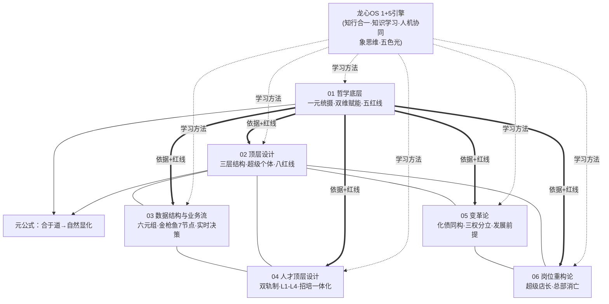

---
title: "AI原生组织知识图谱"
created: "2026-07-29"
version: "1.0"
tags: [AI原生组织, 知识图谱, 关系可视化, 隐秘联系, 以观其妙书院]
author: "以观其妙书院"
source: "六份源文档跨文档关系挖掘"
brand: "以观其妙书院®"
---

# AI原生组织知识图谱

> 本图谱可视化六份文档+龙心OS 1+5引擎之间的体系关系，并标注 7 组跨文档**隐秘知识联系**（虚线高亮）。

## 一、体系关系图（Mermaid）

## 二、关键概念节点

| 概念 | 所属文档 | 关联概念 |
|------|---------|---------|
| 三层结构 | 02/05/06 | 职能切片·超级个体·数据层OS |
| 超级个体 | 02/05/06 | 1人+N组AI包·AI95%/人5% |
| 三权分立 | 05 | 采集权/分析权/决策权·防信息截留 |
| 六元组 | 03 | 责任锚点↔ABCD角·7S映射 |
| 化债同构 | 05/06 | 通胀化债↔组织变革·利益重置 |
| 双维赋能 | 01 | 客观实践维↔主观精神维 |
| 双轨制 | 04 | L1-L4⊕ABCD角·自己长出人 |
| 八红线/五红线 | 02↔01 | 数据不替人判断·判断权不越级 |

## 三、七组隐秘知识联系（跨文档发掘）

1. **化债逻辑贯穿 05/06/02**：通胀稀释债务 ↔ AI稀释中层信息枢纽价值（名义不裁实质权缩水）。变革论方法论根。
2. **5天保鲜期=矛盾分析法的工程化**：01 的"矛盾分析法→注意力机制"在 03 金枪鱼7节点（保鲜期=主要矛盾）落地为可运行代码。
3. **楔子化=阴阳平衡的工程实现**：01"道家阴阳平衡作容错机制"→ 02/03"超级个体楔子"(AI确定性80%+人边界异常20%)。
4. **L1-L4=儒家八条目的组织映射**：01 明确"格物→致知→…→平天下"对应"用眼学→用脑管"。
5. **三权分立=防信息截留复活的制度设计**：05 三权分立 与 02 红线五(判断权不越级) 同源于"信息租金"消除(02 4.7)。
6. **自己长出人↔发展是前提**：04 人才生产线 依赖 05/06 增量空间，无新店新岗位则双轨制沦为零和。
7. **28%成本红线=物质第一性的量化**：03 食材成本率红线 是 01 红线一"客观世界解释权归辩证唯物主义"的经营硬约束。

## 四、关联文件

- [[AI原生组织知识库/NS474E6-00-总索引]]
- [[NS474E6-01-哲学底层-马克思视野下的个人哲学]]
- [[AI原生组织知识库/NS474E6-02-AI原生组织顶层设计]]
- [[AI原生组织知识库/NS474E6-03-AI原生组织数据结构与业务流顶层设计]]
- [[AI原生组织知识库/NS474E6-04-AI原生组织人才顶层设计]]
- [[NS474E6-05-AI原生组织变革论-从科层到人机共生]]
- [[NS474E6-06-岗位重构论-以店长为切入口]]
- [知识图谱.html](知识图谱.html)（可视化版）

## 五、标签

#知识图谱 #关系可视化 #隐秘联系 #体系贯通 #以观其妙书院

<!-- AI-LINKS-BEGIN -->
## 🔗 AI 关联笔记（统一索引生成 · 2026-11-14）

> 由 `00-索引与导航/AI统一索引` 生成；可重跑覆盖，可用回滚脚本还原。

- [[01-核心体系/AI龙龟共生OS升级包3.0/龙龟升级/龙爪OS：AI原生组织岗位智能体/学习资料/岗位智能体生成器-开发文档（AI原生组织版）]] — 岗位智能体生成器 · 开发文档（AI原生组织版）
- [[03-知识地基层/AI原生组织四层体系/NS95769-04-AI原生组织人才顶层设计]] — AI原生组织人才顶层设计·结构化知识文档
- [[03-知识地基层/AI原生组织四层体系/NS95769-09-核心概念手册]] — AI原生组织四层体系·核心概念手册
- [[03-知识地基层/AI原生组织四层体系/NS95769-10-知识图谱]] — AI原生组织四层体系·知识图谱
- [[AI原生组织知识库/书稿/NS98A88-06-第五章-三权分立]] — AI原生组织
- [[AI原生组织知识库/书稿/NS98A88-07-第六章-三权分立]] — AI原生组织

<!-- AI-LINKS-END -->
