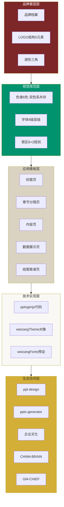
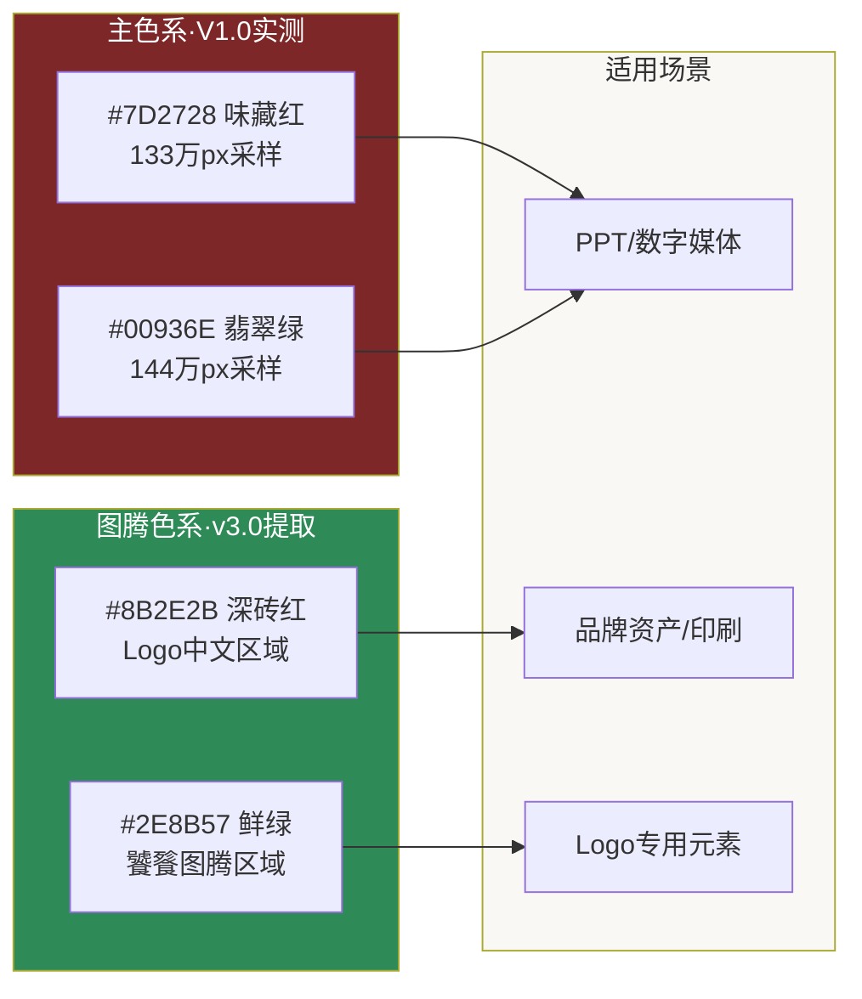
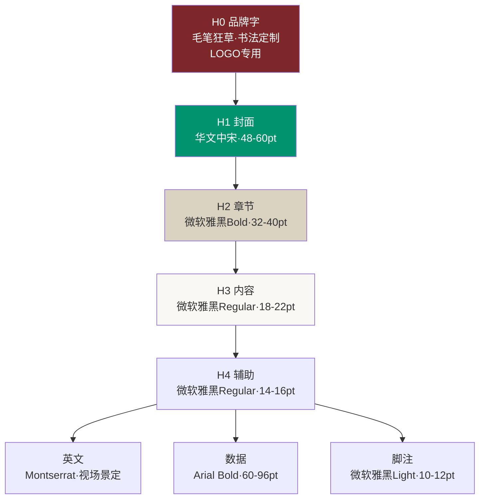
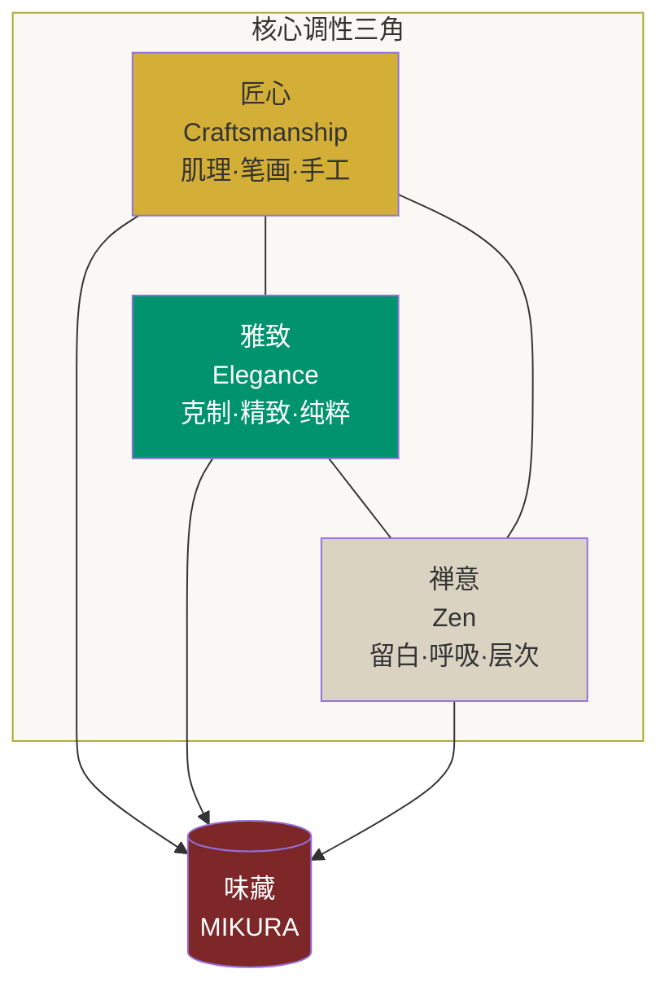
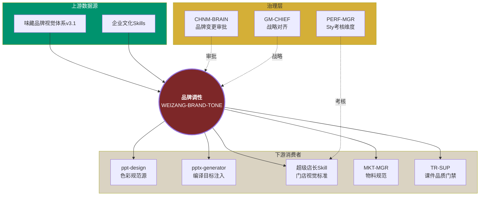

# 味藏品牌调性 - 知识图谱
# Mermaid可视化 | 版本 v1.0
# 2026-06-15 | © 味藏商学院

---

## 图1：品牌调性全景图

---

## 图2：双色系并存架构

---

## 图3：字体层级信息架构

---

## 图4：调性三角三维结构

---

## 图5：生态协同网络

---

## 知识图谱统计

| 图号 | 名称 | 节点数 | 关系数 | 核心价值 |
|------|------|--------|-------|---------|
| 图1 | 全景图 | 18 | 20 | 完整架构一览 |
| 图2 | 双色系 | 7 | 4 | 色值仲裁可视化 |
| 图3 | 字体层级 | 8 | 7 | 信息架构映射 |
| 图4 | 调性三角 | 5 | 6 | 品牌灵魂模型 |
| 图5 | 生态网络 | 11 | 10 | 协同关系图谱 |

**总计**: 49节点 | 47关系 | 5张Mermaid图

---

*© 2026 味藏商学院 · 龙心OS五引擎深度学习产出*

<!-- AI-LINKS-BEGIN -->
## 🔗 AI 关联笔记（统一索引生成 · 2026-11-14）

> 由 `00-索引与导航/AI统一索引` 生成；可重跑覆盖，可用回滚脚本还原。

- [[05-五行人格心理学/理论基石/📜 象思维与五行识人：儒家内圣外王·知识图谱]] — 象思维与五行识人：儒家内圣外王·知识图谱
- [[ψ技能体系/20-claws/02-culture/品牌调性/SKILL]] — 味藏品牌调性智能体 V1.1
- [[ψ技能体系/20-claws/02-culture/品牌调性/test-cases_v1.0]] — 味藏品牌调性 - 测试用例集
- [[ψ技能体系/20-claws/02-culture/品牌调性/核心金句集_v1.0]] — 味藏品牌调性 - 核心金句集
- [[ψ技能体系/20-claws/02-culture/品牌调性/龙心OS深度学习白皮书_v1.0]] — 味藏品牌调性智能体
- [[ψ技能体系/30-tools/品牌调性/SKILL]] — 味藏品牌调性智能体 V1.1

<!-- AI-LINKS-END -->
