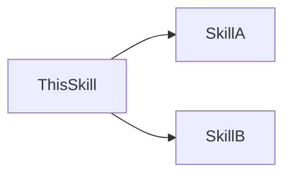

# Skill 质量底线标准

> ✅ 所有 Skill 必须满足的最低质量标准

---

## 📋 质量底线（必须满足）

以下 5 项是 Skill 发布的**最低要求**，任何一项不满足则拒绝发布。

### 1. 核心定义 <30 字

**检查方式**: 字数统计

**标准**:
```markdown
# [SkillName]

> **核心定位**：[一句话定义，必须<30 字]
```

**示例**:
- ✅ "五行人格类型识别与分析工具" (13 字)
- ❌ "这是一个用于帮助用户分析其五行人格类型的综合性工具，能够根据用户提供的各种信息进行深度分析并给出详细报告" (52 字)

---

### 2. 触发关键词权重表完整

**检查方式**: 文件存在性 + 内容检查

**标准**:
```yaml
# triggers/trigger-rules.yaml
P0:  # 权重 5 - 绝对触发
  - 关键词 1
  - 关键词 2

P1:  # 权重 4 - 强触发
  - 场景描述 1
  - 场景描述 2

P2:  # 权重 3 - 弱触发
  - 信号 1
  - 信号 2
```

**必须包含**:
- [ ] P0 关键词至少 2 个
- [ ] P1 场景至少 2 个
- [ ] P2 信号至少 1 个

---

### 3. 测试用例至少 3 个

**检查方式**: 数量检查

**标准**:
```markdown
## 测试用例

### 用例 1：标准场景
输入：[常见输入]
预期输出：[预期结果]

### 用例 2：边界场景
输入：[特殊输入]
预期输出：[预期结果]

### 用例 3：负面场景
输入：[不应触发的输入]
预期：不触发或明确拒绝
```

**必须包含**:
- [ ] 标准场景测试
- [ ] 边界场景测试
- [ ] 负面场景测试

---

### 4. 与其他 Skills 关系图清晰

**检查方式**: 视觉检查

**标准**:
```markdown
## 与其他 Skills 的关系

| 协作 Skill | 调用时机 | 优先级 |
|------------|----------|--------|
| SkillA | 场景 X | High |
| SkillB | 场景 Y | Medium |
```

或



**必须包含**:
- [ ] 至少识别 1 个协作 Skill（或明确说明独立）
- [ ] 调用时机清晰
- [ ] 优先级明确

---

### 5. 版本迭代计划明确

**检查方式**: 文件存在性

**标准**:
```markdown
## 版本迭代

| 版本 | 时间 | 改动点 |
|------|------|--------|
| v1.0 | 2026-04-13 | 初始版本 |
| v1.1 | [计划] | [计划改进] |
```

**必须包含**:
- [ ] 当前版本号
- [ ] 发布日期
- [ ] 改动点描述
- [ ] 下版本计划（可选但推荐）

---

## 🌟 质量推荐（提升标准）

以下项目不是必须，但满足后能显著提升 Skill 质量。

### 1. 真实案例 ≥3 个

**价值**: 提升实用性，帮助用户理解使用场景

**标准**:
```markdown
## 使用示例

### 场景 1：[真实案例名称]
**输入**：[用户实际输入]
**输出**：[实际输出结果]

### 场景 2：...
### 场景 3：...
```

---

### 2. 异常处理完整

**价值**: 提升稳定性，减少用户困惑

**标准**:
```markdown
## 边界条件与异常

| 异常情况 | 处理方式 |
|----------|----------|
| 输入不规范 | [具体处理方式] |
| 触发冲突 | [具体处理方式] |
| 依赖 Skill 不可用 | [具体处理方式] |
| API 调用失败 | [具体处理方式] |
```

---

### 3. 文档完整度 ≥80%

**价值**: 提升可维护性，便于后续迭代

**检查项**:
| 文档 | 状态 |
|------|------|
| SKILL.md | ✅ 必须 |
| references/theory.md | ⭕ 推荐 |
| references/practice-guide.md | ⭕ 推荐 |
| templates/input_template.md | ✅ 必须 |
| templates/output_template.md | ✅ 必须 |
| triggers/trigger-rules.yaml | ✅ 必须 |

---

## 🔍 质量检查流程

### 自动检查（Skill Builder 执行）

```powershell
# 检查核心定义字数
$definition = Get-Content SKILL.md | Select-String "核心定位"
if ($definition.Length -gt 50) {
    Write-Error "核心定义超过 30 字"
}

# 检查触发词文件
if (-not (Test-Path triggers/trigger-rules.yaml)) {
    Write-Error "缺少触发词权重表"
}

# 检查测试用例
$tests = Get-Content SKILL.md | Select-String "用例"
if ($tests.Count -lt 3) {
    Write-Error "测试用例少于 3 个"
}
```

### 人工检查（发布前审查）

| 检查项 | 检查人 | 日期 | 状态 |
|--------|--------|------|------|
| 核心定义 | | | ⬜ |
| 触发词表 | | | ⬜ |
| 测试用例 | | | ⬜ |
| 关系图 | | | ⬜ |
| 版本计划 | | | ⬜ |

---

## 📊 质量评分卡

| 维度 | 权重 | 得分 (0-5) | 加权得分 |
|------|------|------------|----------|
| 核心定义清晰度 | 20% | | |
| 触发机制准确性 | 20% | | |
| 测试覆盖度 | 20% | | |
| 文档完整度 | 20% | | |
| 实用性 | 20% | | |
| **总分** | 100% | | **/5** |

**评级标准**:
- 🟢 4.5-5.0: 优秀，可直接发布
- 🟡 3.5-4.4: 良好，建议优化后发布
- 🟠 2.5-3.4: 合格，满足底线可发布
- 🔴 0-2.4: 不合格，需重大改进

---

## 🔄 持续改进机制

### 反馈收集

每次 Skill 使用后，自动收集：
- 触发是否准确？
- 输出是否有用？
- 有无异常情况？

### 月度审查

每月最后一个周五：
1. 审查所有 Skill 的使用数据
2. 识别低分 Skill（<3.5）
3. 制定优化计划
4. 更新版本

### 季度迭代

每季度：
1. 审查质量底线标准本身
2. 根据实践调整标准
3. 更新 Skill Builder 模板

---

_龙心 OS Skill 质量底线 v1.0 · 最后更新：2026-04-13 · 悟空 × 龙龟 共同维护_

<!-- AI-LINKS-BEGIN -->
## 🔗 AI 关联笔记（统一索引生成 · 2026-11-14）

> 由 `00-索引与导航/AI统一索引` 生成；可重跑覆盖，可用回滚脚本还原。

- [[20-工作记录与复盘/01-长期记忆档案/MEMORY备份-来自22]] — MEMORY备份.md - 龙龟神将长期记忆
- [[09-技能库/skill-builder/standards/QUALITY_BASELINE]] — Skill 质量底线体系 v1.0
- [[09-技能库/skill-builder/standards/QUALITY_CHECKLIST_TEMPLATE]] — Skill质量检查表模板 v1.0
- [[09-技能库/上下文工程.skills/CHECKLIST]] — 上下文工程.skills 构建检查清单
- [[ψ技能体系/00-foundation/llm-wiki/llm-wiki-knowledge-base/CHECKLIST]] — LLM Wiki 知识库 Skill — 构建检查清单
- [[ψ技能体系/10-kernel/龙心OS/engines/知行合一/CHECKLIST]] — 知行合一 Skill 检查清单

<!-- AI-LINKS-END -->
