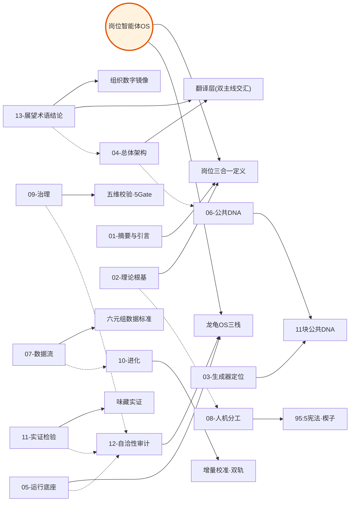

---
title: "岗位智能体OS·知识图谱"
compiled_by: 龙心OS(1+5) · 龙龟神将
---

# 岗位智能体OS · 知识图谱（Mermaid）

> 节点=章节(圆角)与核心概念(矩形)；实线=主从关系，虚线=隐秘跨章同构。

<!-- AI-LINKS-BEGIN -->
## 🔗 AI 关联笔记（统一索引生成 · 2026-11-14）

> 由 `00-索引与导航/AI统一索引` 生成；可重跑覆盖，可用回滚脚本还原。

- [[13-WorkBuddy-Sync/2026-07-20]] — 2026-07-20 工作日志
- [[03-知识地基层/一心三界五行九层/NS0D2AB-11-知识图谱]] — 一心三界五行九层_11-知识图谱
- [[03-知识地基层/一根二道成二果/NS68433-10-知识图谱]] — 10-知识图谱
- [[03-知识地基层/五毒自解与五智慧显发/NSFA506-10-知识图谱]] — 10-知识图谱
- [[03-知识地基层/五行识人组织发展体系/NS39117-11-知识图谱]] — 五行识人组织发展体系_11-知识图谱
- [[AI龙龟共生OS知识库/NSF9349-00-FBB6-知识图谱]] — AI龙龟共生OS·知识图谱

<!-- AI-LINKS-END -->
