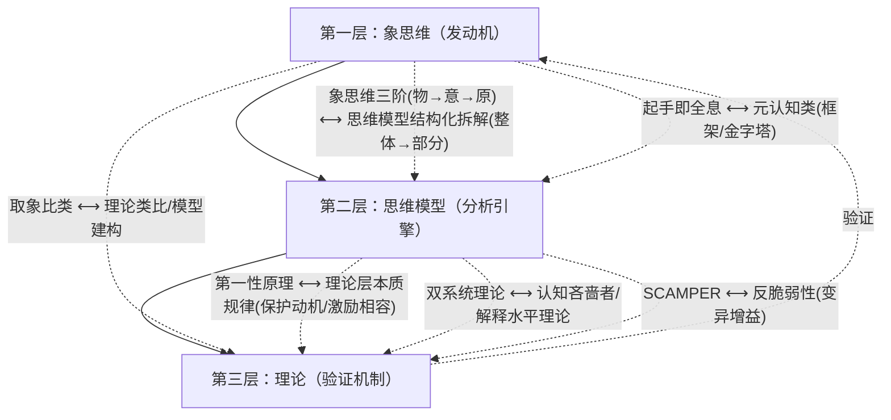

# 龙脑·思维模型 — 知识图谱（跨层关联可视化）

> 三层嵌套架构 + 关键跨层/跨域同构连线。返回 [[_index|总索引]]。

## 概念体系（按层）

### 第一层：象思维（内核 / 发动机）

- [[以象入道，以化见真——释“象道思维”]]
- [[象思维理论]]
- [[象思维理论体系：回归原创之思与实]]
- [[象思维理论体系：回归原创之思与实践路径]]
- [[象道思维：“观·比·体·化”四字循环法]]
- [[象道思维：“观·比·体·化”四字循环法2]]
- [[象道思维：“观·比·体·化”四字循环法高]]

### 第二层：思维模型（分析引擎）

**元认知类**
  - [[思维模型——人类认知的底层操作系统]]
  - [[思维模型框]]
  - [[思维模式-方法论-解决问题”的模型]]
  - [[掌握这100个思维模型，开启你的「超级个体」时代！]]
  - [[框架-思维框架-框架思维]]
  - [[第一性原理]]
  - [[金字塔原理]]
  - [[11种思维模型速查手册]]
  - [[三步矫正思维陷阱]]
  - [[十种知识整合方式]]
  - [[批判性思维]]
  - [[第一层到第二层]]
**问题分析类**
  - [[《麦肯锡思考工具》理论体系梳理与应用研究]]
  - [[5W2H七维分析]]
  - [[「五层分析法]]
  - [[五维重构法]]
  - [[五维问题拆解法]]
  - [[从一团乱麻到清晰方案]]
  - [[从复杂到简单]]
  - [[从锚定方向到破局突围]]
  - [[如果X，那么Y]]
  - [[概率思维]]
  - [[问题的答案]]
**提问工具类**
  - [[6种提问法速查手册]]
  - [[7种高阶提问法速查手册]]
  - [[ORID焦点讨论法]]
  - [[苏格拉底6大提问框架]]
**创意创新类**
  - [[SCAMPER奔驰法]]
  - [[逆向思维工具箱]]
**决策与沟通类**
  - [[8个沟通模型速查手册]]
  - [[双系统理论]]
  - [[视角转换工具箱]]
**自我管理类**
  - [[价值聚焦]]
  - [[动力从来不是行动的前提]]
**易经卦变类**
  - [[易经错综复杂]]
**教员方法论类**
  - [[教员方法论]]

### 第三层：理论（科学支撑 / 验证机制）

**动机行为类**
  - [[PERMA幸福理论]]
  - [[享乐适应理论]]
  - [[保护动机理论]]
  - [[恐惧管理理论]]
  - [[最佳唤醒理论]]
  - [[消费价值理论]]
  - [[激励相容理论]]
  - [[积极情绪的拓展-建构理论]]
  - [[资源保存理论]]
**社会认知类**
  - [[建构发展理论]]
  - [[情感事件理论]]
  - [[情绪认知评价理论]]
  - [[意义构建理论]]
  - [[特质激活理论]]
  - [[组织信息加工理论]]
  - [[解释水平理论]]
  - [[认知-情感-意动框架]]
  - [[认知吝啬者理论]]
**社会关系类**
  - [[主体间性理论]]
  - [[交互记忆系统]]
  - [[他者]]
  - [[嵌入理论]]
  - [[社会促进理论]]
  - [[社会支持理论]]
  - [[社会视觉理论]]
  - [[自我呈现理论]]
**文化系统类**
  - [[创新抵抗理论]]
  - [[反脆弱性]]
  - [[敏捷治理]]
  - [[文化维度理论]]
  - [[道德基础理论]]
  - [[高低语境理论]]
**分析方法类**
  - [[单文章元分析]]
  - [[文本挖掘]]
  - [[比较分析法]]
  - [[过程调节法]]

<!-- AI-LINKS-BEGIN -->
## 🔗 AI 关联笔记（统一索引生成 · 2026-11-14）

> 由 `00-索引与导航/AI统一索引` 生成；可重跑覆盖，可用回滚脚本还原。

- [[01-核心体系/龙脑-思维模型顶层设计/02-思维模型/05-决策与沟通类/11种思维模型速查手册]] — 11种思维模型速查手册
- [[01-核心体系/龙脑-思维模型顶层设计/02-思维模型/09-系统总览类/掌握这100个思维模型]] — 掌握这100个思维模型
- [[03-知识地基层/象思维/NS6EED6-01-理论体系完整十章]] — 象思维理论体系：回归原创之思与实践路径
- [[AI原生组织思维模型/象思维体系/以象入道，以化见真——释“象道思维”]] — 以象入道，以化见真——释“象道思维”
- [[思维模型/01-核心体系/龙脑-思维模型顶层设计/01-象思维/以象入道，以化见真——释“象道思维”]] — 以象入道，以化见真——释“象道思维”
- [[思维模型/01-核心体系/龙脑-思维模型顶层设计/02-思维模型/01-元认知类/掌握这100个思维模型，开启你的「超级个体」时代！]] — 掌握这100个思维模型，开启你的「超级个体」时代！

<!-- AI-LINKS-END -->
