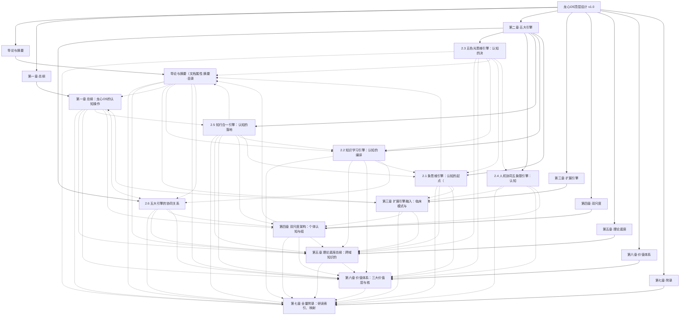

# 龙心OS顶层设计 · 知识图谱

> 龙心 OS(1+5) 编译体系关系图（mermaid）。章组 → 各笔记；跨单元隐秘联系以虚线表示。
> 共 13 篇笔记 / 8 章组。

## 章组分布
- **导论与摘要**（1 篇）：导论与摘要（文档属性·摘要·
- **第一章·总纲**（1 篇）：第一章 总纲：龙心OS的认知
- **第二章·五大引擎**（6 篇）：2.6 五大引擎的协同关系、2.3 五色光思维引擎：认知、2.4 人机协同五象限引擎：、2.5 知行合一引擎：认知的、2.2 知识学习引擎：认知的、2.1 象思维引擎：认知的起
- **第三章·扩展引擎**（1 篇）：第三章 扩展引擎融入：临床模
- **第四章·双尺度**（1 篇）：第四章 双尺度架构：个体认知
- **第五章·理论底座**（1 篇）：第五章 理论底座总纲：跨域知
- **第六章·价值体系**（1 篇）：第六章 价值体系：三大价值层
- **第七章·附录**（1 篇）：第七章 全量附录：研读索引、

<!-- AI-LINKS-BEGIN -->
## 🔗 AI 关联笔记（统一索引生成 · 2026-11-14）

> 由 `00-索引与导航/AI统一索引` 生成；可重跑覆盖，可用回滚脚本还原。

- [[01-核心体系/AI龙龟共生OS升级包3.0/龙龟升级/龙心OS升级包：1+5/龙心OS开发设计文档]] — 龙心OS开发设计文档：从理论蓝图到可运行实现
- [[01-核心体系/AI龙龟共生OS升级包3.0/龙龟升级/龙心OS升级包：1+5/龙心OS顶层设计梳理]] — 龙心OS顶层设计梳理：认知操作系统的方法论体系与工程蓝图
- [[01-核心体系/AI龙龟共生OS升级包3.0/龙龟升级/龙脑OS升级包：思维模型/龙脑动态组方引擎-开发文档]] — 龙脑动态组方引擎 · 开发文档
- [[01-核心体系/核心Skills_人机共生伙伴系统·总索引]] — 人机共生伙伴系统·总索引
- [[01-核心体系/龙心OS_🐉 Dragon OS 系统架构图]] — 🐉 龙心OS · 系统架构图
- [[AI原生组织思维模型/AI原生组织思维模型·知识图谱]] — AI原生组织思维模型 · 知识图谱
- [[ψ技能体系/30-tools/fbs-bookwriter/references/01-core/workflow-volumes/workflow-s5]] — S5 节点

<!-- AI-LINKS-END -->
